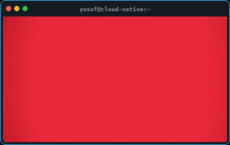

<h1 align="center">Yusuf Kaya</h1>

  

---

<table>
  <tr>
    <td width="54%" valign="middle">
      

        I am a <b>Cloud-Native & On-Prem DevOps Engineer</b> and <b>Agentic AI Developer</b> passionate about automating, securing, and scaling production infrastructure and delivery pipelines.
      

      <ul>
        <li>🔭 Engineering and administering resilient <b>Kubernetes (RKE2, AKS, OKE)</b> clusters and <b>Rancher</b> control planes across cloud and on-prem environments.</li>
        <li>🏗️ Provisioning infrastructure as code and configuration automation with <b>Terraform</b> & <b>Ansible</b>.</li>
        <li>⚙️ Automating declarative <b>GitOps</b> delivery & DevSecOps pipelines with <b>ArgoCD</b>, <b>Jenkins</b>, <b>GitLab CI</b>, <b>Azure DevOps</b>, and <b>Trivy</b>.</li>
        <li>📊 Full-stack observability and resiliency validation with <b>Prometheus</b>, <b>Grafana</b>, and <b>Chaos Engineering (Chaos Mesh)</b>.</li>
        <li>🤖 Building autonomous <b>Agentic AI</b> workflows and backend systems with <b>Python</b>, <b>Bash</b>, <b>.NET</b>, and <b>TypeScript</b>.</li>
      </ul>
    </td>
    <td width="46%" align="center" valign="middle">
      
    </td>
  </tr>
</table>

---

### 🛠️ Tech Stack & Tooling

| Domain | Technologies & Platforms |
| :--- | :--- |
| **☁️ Cloud & IaC** |       |
| **🐳 Containers & K8s** |       |
| **🚀 CI/CD, GitOps & Sec** |       |
| **📊 Observability & Chaos** |    |
| **🗄️ Stateful & Messaging** |      |
| **🤖 AI, Code & OS** |       |

---

### ⚡ Contribution Grid Snake

  

